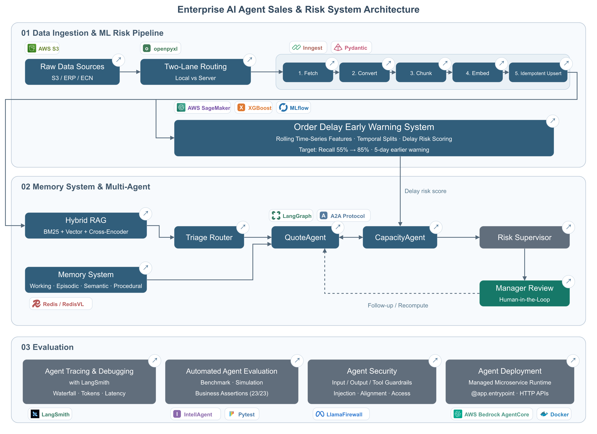

# Enterprise AI Agent: Sales, Quoting & Supply Chain Risk System

**Help manufacturing sales managers prepare feasible quotes, understand delivery constraints, and review alternatives before making a customer commitment.**

[**Live Architecture Demo ↗**](https://enterprise-ai-sales-risk-architecture.dapper-moss-8891.chatgpt.site/#overview) · [ML Risk Model](#ml-risk-model) · [Qualification Report](qualification_report.md) · [Quickstart](#quickstart--graceful-fallback)

A fictional customer requests **5% off 12,000 units with delivery in 14 days**. The latest engineering change requires **28 days**, and the preferred factory has only **2,000 units available**. The system retrieves current evidence, checks pricing and both factories, proposes a feasible alternative, and leaves approval with the manager. A quantity change triggers recalculation and invalidates the previous approval.

**Recorded acceptance:** 23/23 synthetic business cases passed, with 23 LangSmith root Run IDs and 106 logical agent model calls. The gate passed for **local release qualification**, not an AWS production rollout. The public demo is an interactive architecture viewer; the executable workflow runs locally.

## System Architecture Overview

[Download high-resolution overview](docs/assets/overview.png) · [Editable SVG](docs/assets/overview.svg)

| Layer | Business purpose | Flow |
|---|---|---|
| **01 Data Ingestion & ML Risk Pipeline** | Keep engineering evidence current and surface potential delivery delays | Two-lane ingestion → durable checkpoints → current evidence; planned point-in-time ML features → risk scoring |
| **02 Memory System & Multi-Agent** | Generate customer-specific options that respect costs, capacity and prior commitments | Scoped retrieval + four memory types → Triage Router → QuoteAgent ↔ CapacityAgent → Risk Supervisor → Manager Review |
| **03 Evaluation** | Explain failures, reject invalid proposals and control release readiness | LangSmith tracing · business evaluation · security controls · AgentCore deployment checks |

**Implementation boundary:** local ingestion, memory, RAG, LangGraph tool calling, business assertions and AgentCore HTTP contracts are implemented. The SageMaker/XGBoost risk extension, hosted Inngest, browser WASM, LlamaFirewall and IntellAgent integrations are designs. Their diagrams describe the intended architecture, not completed deployments.

## Ingestion & ETL

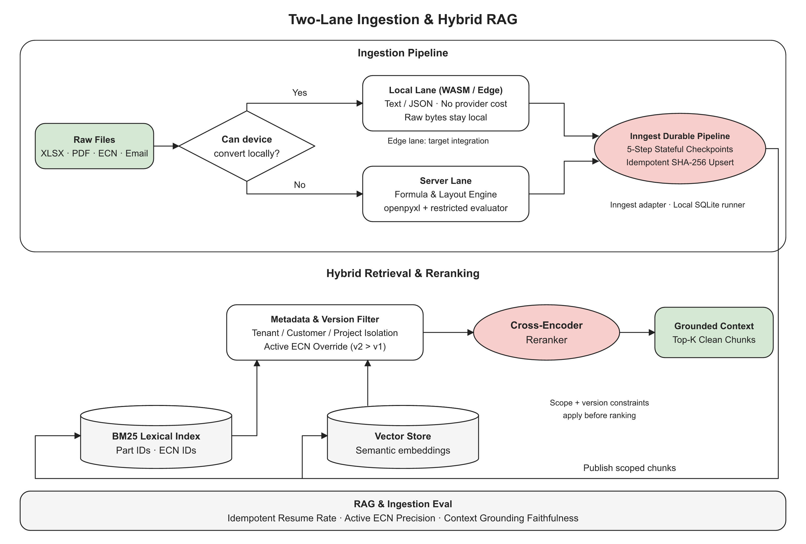

[SVG](docs/assets/rag_ingestion_architecture.svg)

Two-lane routing separates lightweight conversion from workbooks and layouts that need server-side processing. The pipeline records **Fetch → Convert → Chunk → Embed → Idempotent Upsert** as durable steps, binds content and metadata to SHA-256 identifiers, and publishes only validated current versions.

- **Business validation:** verify customer/project ownership, ECN versions, required lead times and BOM arithmetic before evidence is indexed.
- **Recovery:** completed steps are reused after failure; atomic publication and replay checks prevent duplicate documents.
- **Spreadsheet correctness:** openpyxl reads workbook contents. A separate restricted formula evaluator computes supported formulas and rejects unsupported or inconsistent inputs.
- **Current implementation:** SQLite-backed checkpoints and an Inngest integration wrapper. Hosted Inngest and browser WASM conversion remain unverified.

**Retry-cost target: 80% fewer repeated step executions** in the illustrative case where four of five equal-cost steps have completed. This is not a measured billing reduction. The implemented embedding-failure test skips Fetch, Convert and Chunk, then resumes Embed and Upsert; actual savings depend on step cost and failure location. External API acceptance followed by a crash may still cause repeat billing without provider idempotency.

## ML Risk Model

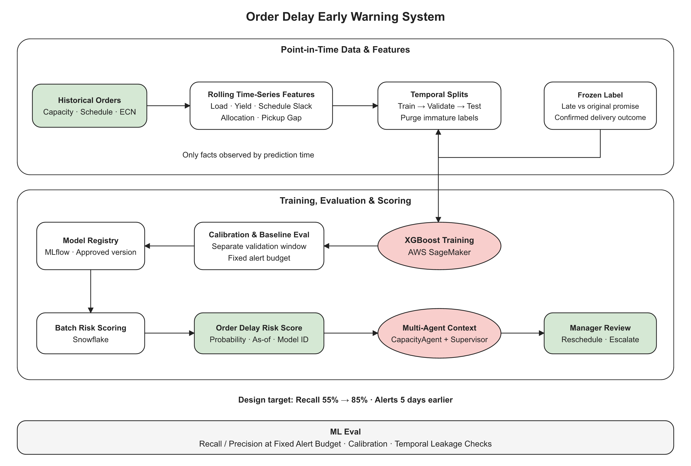

[SVG](docs/assets/ml_risk_architecture.svg) · [Open interactive ML view](https://enterprise-ai-sales-risk-architecture.dapper-moss-8891.chatgpt.site/#ml)

The **Order Delay Early Warning System** is the planned V2 extension using **AWS SageMaker + XGBoost + MLflow**:

1. Build **Rolling Time-Series Features** from committed capacity, production schedules, yield, customer allocation, pickup-versus-forecast gaps and design changes.
2. Reconstruct only facts available at each prediction time. Use **Temporal Splits**, separate validation windows and mature delivery labels to avoid future-information leakage.
3. Train XGBoost on SageMaker, calibrate scores on validation data, and compare against rules at the **same alert budget**. Record model and dataset versions in MLflow.
4. Run approved batch scoring in Snowflake. Pass the **Delay Risk Score**, prediction timestamp and model version to **CapacityAgent** and the supervisor for scheduling review.

**Design targets—not measured results:** improve recall from **55% to 85%** and flag risk **five days earlier**. The earlier separate logistic prototype measured approximately **54.3% recall**, matching its rules baseline at the same alert budget. No SageMaker/XGBoost training or improvement to 85% is claimed by this V2 release. Production benefit requires time-held-out evaluation and shared-capacity intervention analysis.

## Memory & RAG

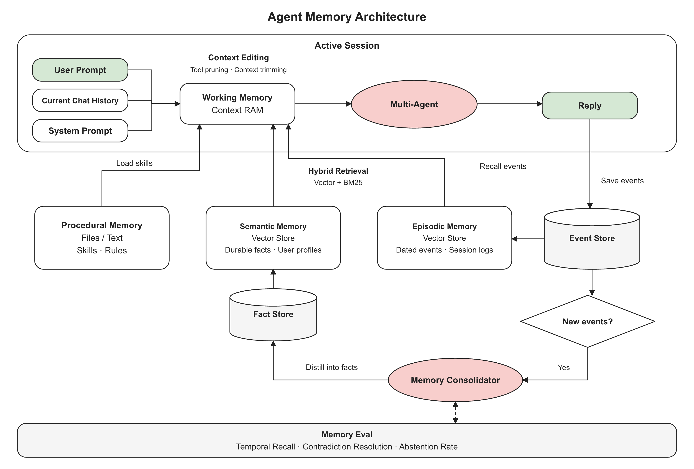

[Memory SVG](docs/assets/memory_architecture.svg)

| Memory | Responsibility |
|---|---|
| **Working** | Bounded tool outputs and session context; SQLite checkpoints by default, with Redis checkpointer selection |
| **Episodic** | Timestamped inquiry events and prior conversations with source and customer/project scope |
| **Semantic** | Confirmed customer profiles and preferences, versioned facts and validity intervals |
| **Procedural** | Trusted pricing and capacity skills loaded from application-controlled files |

The **Memory Consolidator** turns trusted confirmed event fields into facts. Similarity finds duplicate candidates; named facts and equivalent values determine actual deduplication. New confirmed values supersede older versions while preserving history. Out-of-order conflicts wait for review. Engineering source records outrank conversational preferences.


**BM25 + Vector + Cross-Encoder Reranking** combines exact part/ECN matching and semantic retrieval. Authorization and active-version filtering run **before ranking**, so obsolete ECNs and other customers' documents cannot become valid evidence merely by scoring highly. The live acceptance run used local Sentence-Transformers and cross-encoder weights. Offline mode uses deterministic lexical-hash retrieval.

Memory Eval checks temporal recall, contradiction resolution and abstention, including an answerable-query control. These are small synthetic lifecycle tests; their denominators and scope appear in the qualification report. Live Redis and broad unseen-document retrieval quality remain unverified.

## Multi-Agent Orchestration (LangGraph & A2A Protocol)

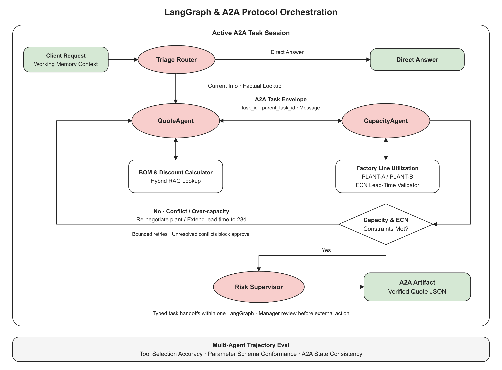

[SVG](docs/assets/multi_agent_a2a_architecture.svg)

- **Triage Router:** direct questions avoid unnecessary tools; current-information requests require current source checks; factual lookups cross-check evidence.
- **QuoteAgent:** retrieves BOM/ECN evidence and confirmed preferences, then calls deterministic pricing tools. Uncommitted future volume cannot silently qualify an order for a discount.
- **CapacityAgent:** checks both factories and the latest ECN lead time. Conflicts trigger a bounded revision of plant or delivery date; unresolved constraints block approval.
- **Risk Supervisor and manager:** validate the proposal, retain evidence and conditions, and require review before an external commitment. Changed quantity, costs or design inputs require recalculation.

Typed **A2A Task Envelopes** carry task IDs, parent relationships, messages and quote artifacts within one LangGraph application. SDK task objects are validated; this is not a distributed A2A discovery/JSON-RPC deployment. Agents propose; tools calculate and enforce business constraints.

## Evaluation, Security & Deployment

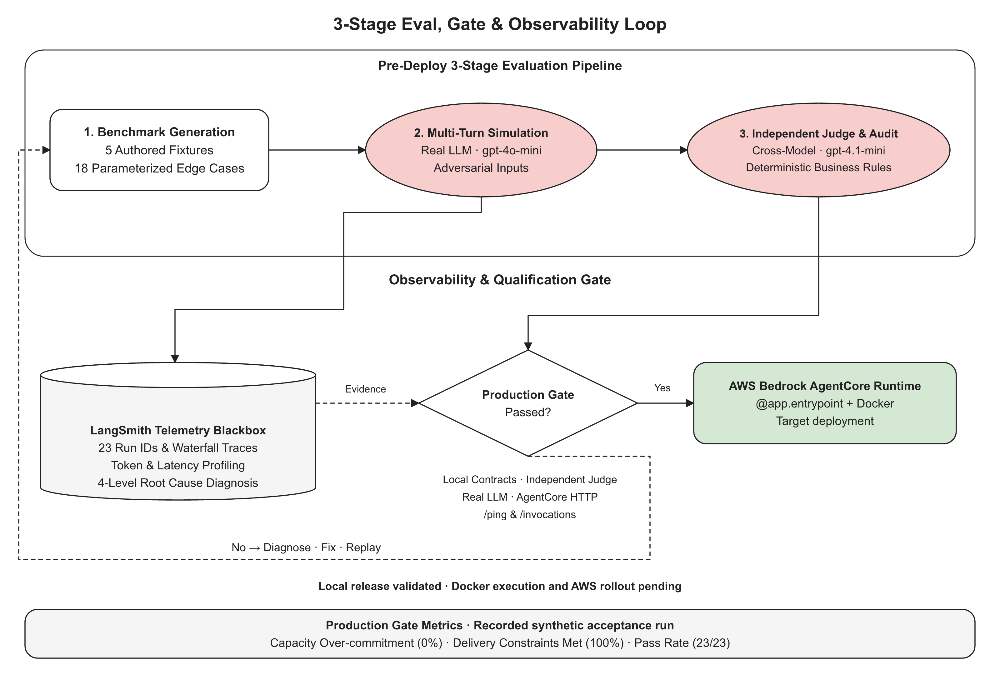

[SVG](docs/assets/eval_observability_architecture.svg) · [Frozen qualification report](qualification_report.md) · [Machine-readable acceptance summary](docs/evidence/acceptance-summary.json)

The recorded batch contains **5 authored fixtures + 18 parameterized cases**. Twenty-two cases used real inference without fallback; one malformed request was rejected before inference. A separate `gpt-4.1-mini` judge reviewed project-authored expectations alongside deterministic assertions. This is independent-model consistency review, not independent human expert labeling.

| Recorded metric | Result | Scope |
|---|---:|---|
| Business case pass rate | **23/23 (100%)** | All applicable assertions per synthetic case |
| Capacity over-commitment | **0%** | Non-blocked proposals versus selected factory availability |
| Delivery constraints met | **100%** | Quote cases satisfying the active ECN minimum lead time |
| Calculation checks | **100%** | Exact cost, revenue and margin assertions |
| Critical conditions retained | **100%** | Required evidence and discount/engineering conditions |
| Independent model consistency review | **23/23** | Existing project-authored reference rules |
| LangSmith root Run IDs | **23** | Includes the validation rejection |
| Logical agent model calls | **106** | Final acceptance batch; excludes earlier probes and judge usage |
| Agent token usage | **131,324** | 127,235 input + 4,089 output tokens |

### Agent Tracing & Debugging with LangSmith

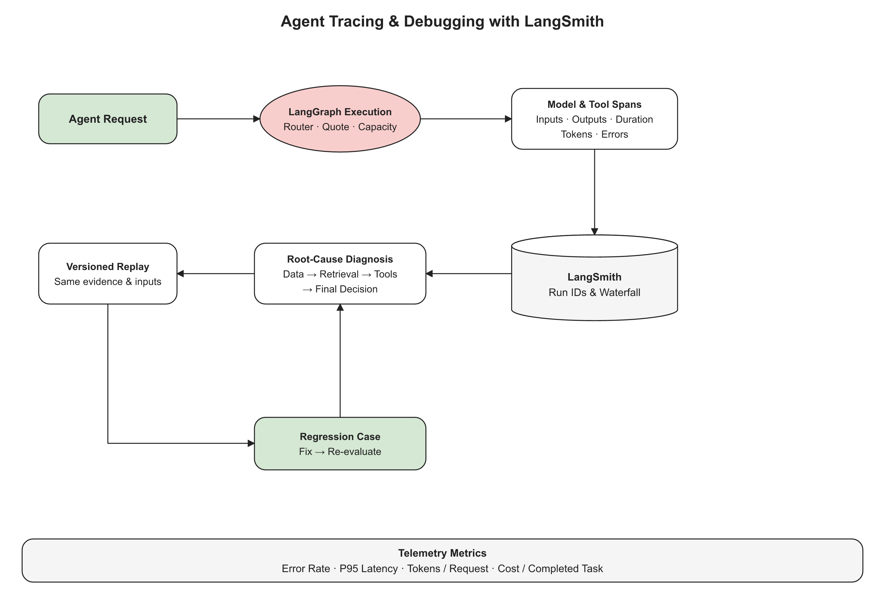

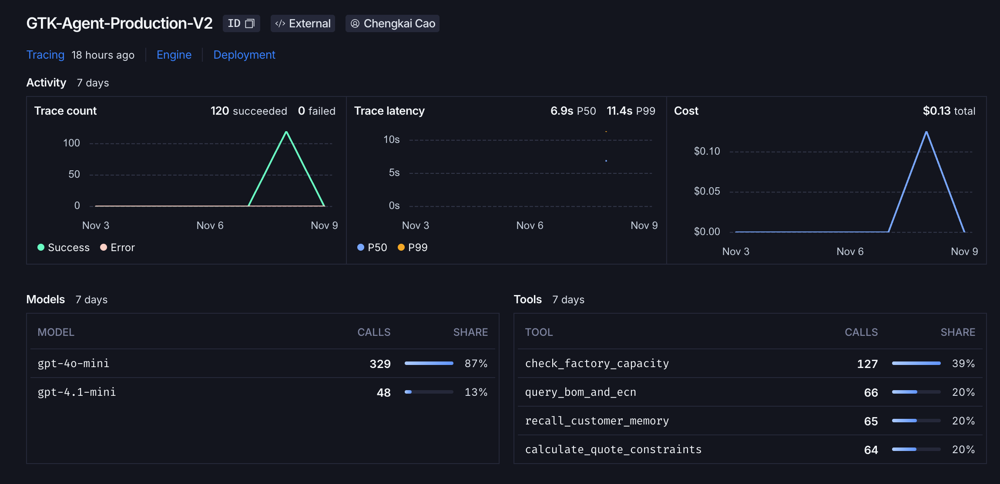

Root and child runs record node transitions, tool arguments, model calls, token usage and latency. Waterfall traces support diagnosis across **data → retrieval → tools → final decisions**. The screenshot is a seven-day activity aggregate including diagnostics and other runs; its 120 traces and model-call totals are **not the same denominator** as the 23-case acceptance batch. Detailed case Run IDs are retained in the report; private LangSmith access is not required to read this repository.

### Automated Agent Evaluation

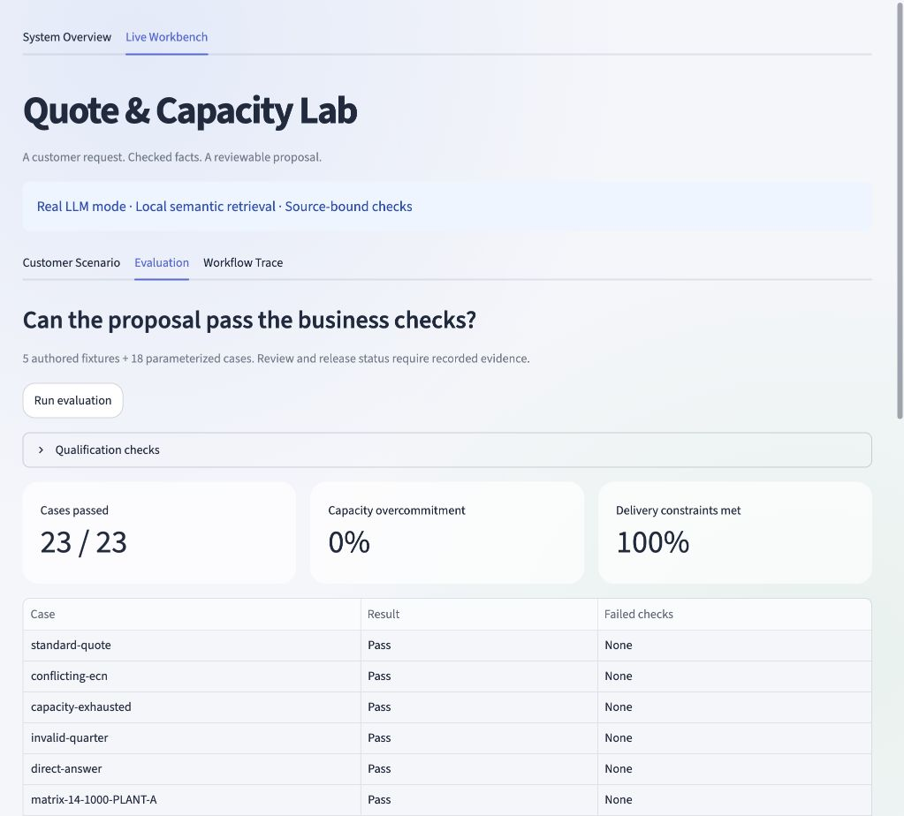

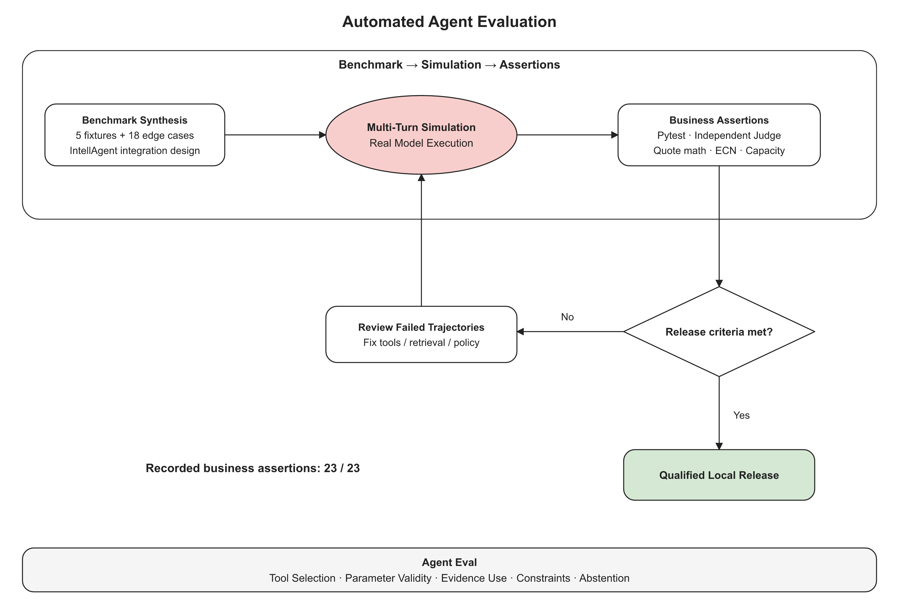

Benchmark generation, simulation and Pytest-backed business assertions test stale ECNs, invalid quarters, exhausted capacity, discount conditions, recalculation and deliberately corrupted outputs. **IntellAgent is a proposed integration**; the measured 23/23 result comes from the implemented authored harness and model judge. Passing these fixtures establishes tested contract behavior, not generalized production accuracy or sales impact.

### Agent Security

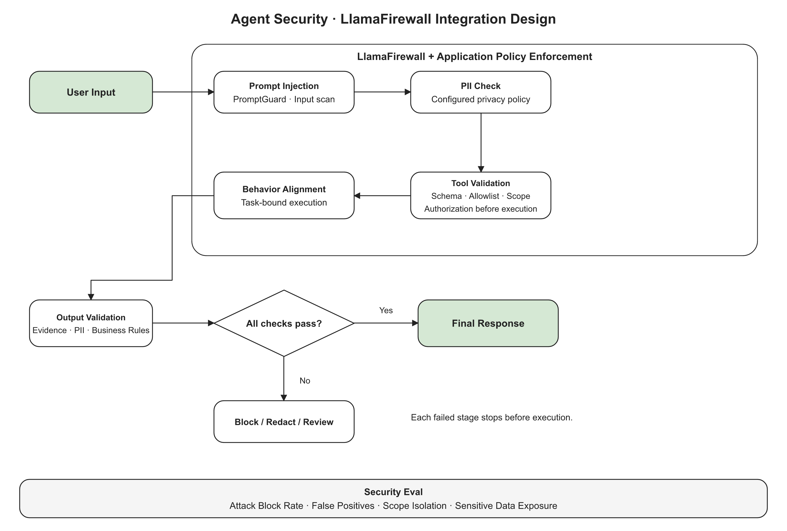

The target **LlamaFirewall** design combines Input/Output/Tool Guardrails, prompt-injection checks and behavior alignment with application-level PII policies, scoped authorization and schema validation. **LlamaFirewall is not installed or evaluated in this release.** Implemented controls reject caller-supplied customer identities, enforce customer/project scope, validate tool parameters and block inconsistent arithmetic or business conditions. A content scanner cannot replace these controls.

### Agent Deployment

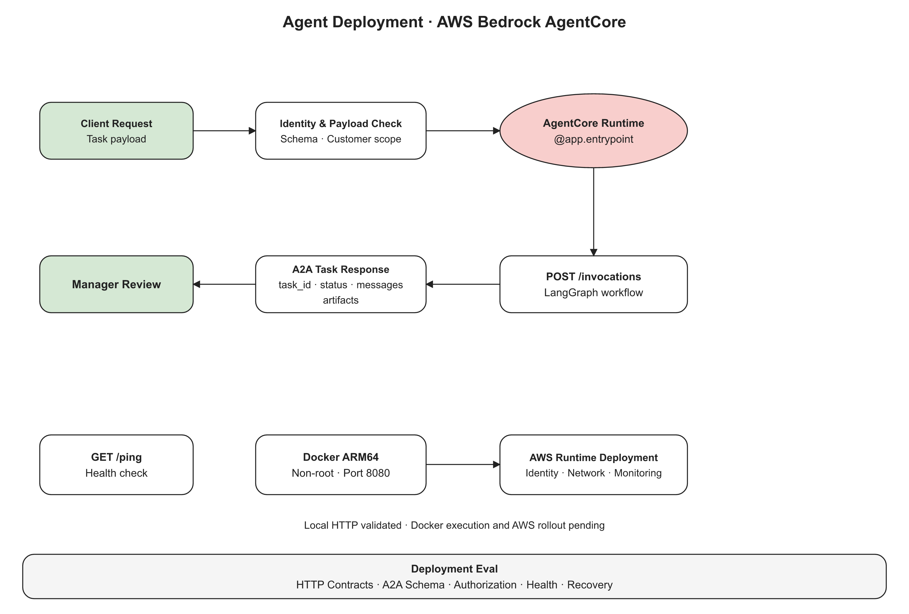

The actual AWS Bedrock AgentCore SDK wraps `invoke(payload)` with `@app.entrypoint`. Local checks exercise **GET `/ping`**, **POST `/invocations`**, malformed payloads, authorization and customer-scope injection. The Dockerfile targets ARM64 and non-root execution; **image execution and AWS rollout have not been verified**.

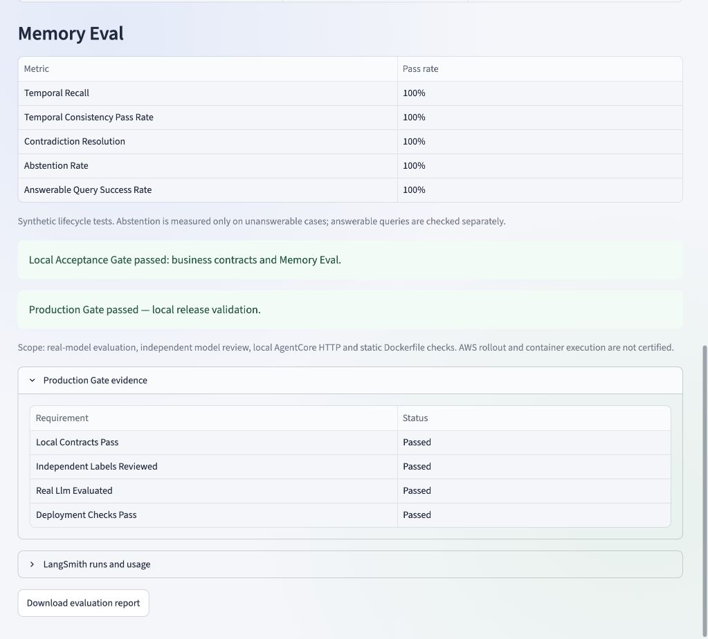

The displayed **Production Gate: Passed** uses the explicit `local_release` policy: local contracts, separate-model review, real inference/traces and local HTTP/static Dockerfile checks. Cloud production qualification additionally requires container and AWS evidence. UI changes do not upgrade the qualification scope.

## Quickstart & Graceful Fallback

Use Python 3.11. All fixture customers, plants, orders and engineering documents are synthetic.

```bash
python3.11 -m venv .venv
source .venv/bin/activate
python -m pip install -r requirements.txt
AGENT_MODE=mock python -m scripts.demo
AGENT_MODE=mock python -m pytest -q
AGENT_MODE=mock python -m streamlit run app/architecture_dashboard.py --server.address 127.0.0.1 --server.port 8770 --browser.gatherUsageStats false
```

The demo generates sources, runs ingestion and agents, and evaluates all 23 cases without paid services. **System Overview** opens the architecture; **Live Workbench** opens the scenario, evaluation and workflow trace. Without `OPENAI_API_KEY`, `auto` mode chooses deterministic execution. Missing weights or failed live contracts produce a visible fallback; fallback never qualifies as a real-LLM pass.

For real inference and tracing:

```bash
python -m pip install -e '.[test,runtime,semantic]'
cp .env.example .env
chmod 600 .env
python -m scripts.prepare_models
```

Edit `.env` locally, filling `OPENAI_API_KEY`, `OPENAI_MODEL=gpt-4o-mini`, `JUDGE_MODEL=gpt-4.1-mini`, `LANGSMITH_API_KEY`, `LANGCHAIN_TRACING_V2=true`, and your `LANGSMITH_PROJECT`. Set `EMBEDDING_MODEL_PATH=runtime/models/embedding` and `RERANKER_MODEL_PATH=runtime/models/reranker`. Legacy `LANGCHAIN_API_KEY` / `LANGCHAIN_PROJECT` aliases are supported. No keys belong in source, screenshots or issues.

```bash
QUALIFICATION_SCOPE=local_release python -m scripts.qualify --root runtime/live-qualification --live --http --reference-existing-rules --review-labels
python -m scripts.qualification_report --root runtime/live-qualification
AGENT_STUDIO_ROOT=runtime/live-qualification python -m streamlit run app/architecture_dashboard.py --server.address 127.0.0.1 --server.port 8770
```

Live qualification calls paid APIs and uploads synthetic traces to the configured LangSmith project. Model preparation downloads lightweight encoder/reranker weights; it does not run a local generative model. See [qualification setup](config/production-qualification.md) and [local-release policy](config/local-release-policy.md).

Rebuild diagrams and the public static viewer:

```bash
python -m pip install -r docs/diagrams/requirements.txt
python -m scripts.render_architecture
python -m scripts.render_system_views
python -m scripts.export_assets
python -m http.server 8780 --directory docs/site
```

## Repository Map

```text
app/             Glass-style architecture viewer and dashboard wrapper
agent/           LangGraph routing, tool calls, proposals and review boundary
data_pipeline/   Conversion, validation, checkpoints and idempotent ingestion
memory/          Working, episodic, semantic and procedural memory
rag/             Scoped hybrid retrieval and optional semantic reranking
evaluation/      Fixtures, business assertions, judge, memory eval and gates
deployment/      AgentCore HTTP entrypoint, self-checks and Dockerfile
mock_data/       Anonymous synthetic business inputs
scripts/         Demo, qualification, diagram export and security audit
tests/          Offline contracts, recovery, isolation and regression checks
docs/assets/     High-resolution diagrams and dashboard evidence
docs/site/       Public read-only architecture viewer
```

V2 replaces the earlier prototype at the repository root; previous versions remain in Git history. [MIT license](LICENSE). Brand assets retain their respective owners' rights; [asset sources](docs/diagrams/brands/README.md).
