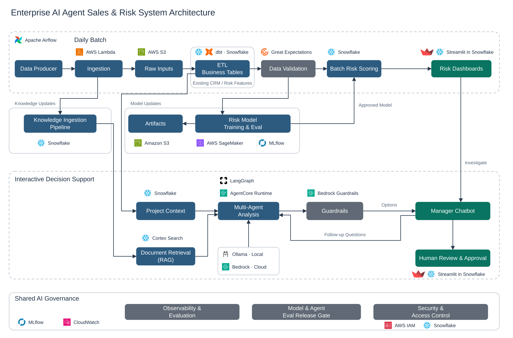

# Enterprise Sales & Supply Chain Planning Agent

[](https://github.com/TheTen888/Enterprise-Sales-Supply-Chain-Planning-Agent/actions/workflows/ci.yml)

**Help manufacturing sales managers spot delivery risks and prepare customer quotes they can explain.**

When a customer asks for a lower price or changes an order, sales needs answers from engineering and supply planning: What does the change cost? Can the shared production line deliver? Which conditions must stay in the quote? This system brings those facts into one reviewable proposal.

**v0.3 is a runnable, zero-cost local prototype.** It uses invented data, deterministic business and engineering roles, and a small delivery-risk model. Cloud services in the architecture are target integrations; no language model or paid API is required.

## What business problem does it solve?

| Business question | How the system helps |
|---|---|
| **Can we deliver this order on time?** | Combine order quantity, shared capacity, schedule slack, yield, design changes, allocation and pickup gaps into risk scores and capacity checks. Compare the model with rules before relying on it. |
| **Can we justify our quote to the customer?** | Bring current order costs together with customer emails and engineering documents. Prepare keep-price, requested-discount and counteroffer options with the conditions that support them. |
| **What changes when the manager revises the plan?** | Recalculate quote totals and capacity, save a new draft, and require a fresh decision. A what-if quantity never silently becomes a customer commitment. |
| **Can we trust the proposal?** | Check customer access, source versions, evidence conditions and arithmetic. Record manager feedback and block approval when inputs are stale or capacity is insufficient. |

The intended benefit is less time assembling information and fewer decisions made from inconsistent facts. Revenue growth, cost savings and avoided delays have not been measured.

## System overview

[](architecture/overview.svg)

**Target architecture:** S3 retains raw inputs. Existing CRM data, business tables, RAG, daily batch scoring and dashboards stay in Snowflake; SageMaker handles training. Multi-Agent Analysis prepares drafts for manager review, with evaluation and access controls shared across the system.

**Current runtime:** Python, SQLite, local keyword retrieval and a portable numeric model implement the core contracts below. The diagram describes the cloud design, not an already deployed cloud system. [Explore module boundaries and technology choices →](architecture/README.md)

## Walk through one customer request

A fictional customer asks for **5% off a 12,000-unit order**.

1. **Get the current facts.** ETL publishes the latest valid order. Scoped retrieval returns customer email and engineering evidence: future volume is unsigned, required inspection cannot be removed, and no volume-based cost reduction is approved.
2. **Build the options.** Engineering confirms a **$13.00 unit cost**. Business compares the $15.00 current price, the customer's $14.25 request and a $14.45 counteroffer. The requested price falls below the fictional 10% margin floor; the counteroffer clears it. Calculations use integer cents.
3. **Test the manager's change.** Increasing the scenario to **18,000 units** raises total cost from **$156,000 to $234,000** and creates a **4,000-unit capacity gap**. Approval is blocked, the previous approval cannot carry over, and the published order remains 12,000 units.
4. **Review the decision.** Managers compare options, ask guided follow-ups, approve an eligible internal draft or reject it with a reason. Feedback keeps its draft and evidence versions and waits for review before it can become an evaluation label.

[Five-minute walkthrough](docs/showcase.md) · [Quote and approval rules](docs/multi-agent-review.md) · [Evidence retrieval example](docs/rag-audit-walkthrough.md)

## Run the showcase

Requires Python 3.11. No credentials, cloud account or language-model download.

```bash
python3.11 -m venv .venv
.venv/bin/python -m pip install -r requirements-ci.txt -r requirements-risk.txt
.venv/bin/python -m scripts.verify --agents
.venv/bin/python -m scripts.serve_showcase
```

Open **[Decision Workspace](http://127.0.0.1:8769/workbench)** to generate and revise a proposal. Open **[Evaluation Studio](http://127.0.0.1:8769/#agents)** to inspect test results and the workflow event sequence. Both run locally; the links work after starting the server.

Each session saves its synthetic state under ignored `artifacts/`. Stop with Ctrl-C; see [session and resume instructions](docs/showcase.md). Customer sending is disabled.

<details>
<summary>Run individual modules</summary>

```bash
.venv/bin/python -m scripts.run_local
.venv/bin/python -m scripts.review_rag
.venv/bin/python -m scripts.run_risk_model
.venv/bin/python -m scripts.run_agents
.venv/bin/python -m scripts.demo_model_contracts
```

ETL and RAG need only Python's standard library. Training and full verification use the installed test/ML dependencies. Model-adapter demonstrations inject fake SDK responses; they never start local LLM inference or connect to a real model API.

</details>

## How do we know it works?

The [recorded verification](docs/evidence/verification.json) contains **230 passing tests, zero skips**, and reproducible synthetic experiments:

| Concern | Evidence |
|---|---|
| Lost or duplicated updates | Five ETL failure/recovery experiments and four load scenarios, checked against independent reconciliation |
| Wrong customer or stale evidence | Nine RAG query cases and five update, deletion and permission experiments |
| Incorrect quotes or unsafe approval | 14 workflow checks, nine controlled failures and seven manager-feedback checks |
| Delivery-risk prediction | Chronological holdout, point-in-time features, frozen commitments, pending labels and the same alert budget for rules and ML |
| Future model integration | Eight mock SDK calls exercise guarded tool selection and response checks; 4 development and 16 acceptance cases await independent label review |

**The risk model is not promoted.** Rules and logistic regression each find 25 of 46 known late orders: **54.3% recall at the same 36-alert budget**. Better ranking scores alone do not justify replacing the baseline. These are synthetic results, not production accuracy.

Real LLM quality, latency and cost remain **unmeasured**. Model qualification stays blocked. Evaluation Studio separates those limits from passing local correctness checks.

[Evaluation design](docs/eval-ui.md) · [Labels, features and leakage controls](docs/risk-model-review.md) · [Offline model interfaces](docs/model-adapters.md)

## What is implemented?

| Runs in this repository | Still requires integration and validation |
|---|---|
| Incremental ETL, deduplication, versioning and atomic local publication | Live database/Gmail ingestion, S3, Airflow and Snowflake/dbt execution |
| Customer/project-scoped retrieval, bounded context, citations and lifecycle checks | Cortex Search deployment, semantic quality and production identity |
| Synthetic risk training, temporal evaluation and portable batch scoring | Real labels, intervention-aware evaluation, SageMaker training and Snowflake scoring |
| Deterministic engineering/business roles, quote tools, draft revisions and internal review | LLM-backed LangGraph/AgentCore execution and general chatbot conversations |
| Decision Workspace, Evaluation Studio, persisted events and local session metrics | Distributed workers, live CloudWatch telemetry and a controlled production rollout |
| Disabled-by-default Snowflake, Gmail and Bedrock adapter call paths | Real credentials, service compatibility and cloud deployment |

[Implementation status](docs/implementation-status.md) documents the exact boundaries. [Architecture contracts](architecture/README.md) explain why engineering checks costs before business prices options and why manager disagreement is not automatically ground truth.

## Repository guide

```text
architecture/   System overview and module contracts
pipelines/etl/  Incremental data publication and recovery
rag/           Scoped evidence retrieval and document lifecycle
risk_model/    Historical features, labels, training and scoring
agents/        Quote workflow, revisions, checks and evaluation
app/           Decision Workspace and Evaluation Studio
integrations/  Optional service adapters and offline call contracts
scripts/       Runnable demos, verification and release checks
data/          Invented fixtures and evaluation cases
tests/         Business, data, recovery and access boundaries
docs/          Walkthroughs, trade-offs and measured evidence
```

## CI, data and credentials

[GitHub Actions](.github/workflows/ci.yml) runs lint, full local verification and release-file checks with live services disabled. The badge links to actual hosted results. Local test success alone is not evidence of cloud deployment.

[release-files.txt](release-files.txt) defines the reviewed source set. `.env.example` contains no credentials and disables live access. Keys, OAuth tokens, databases, generated model artifacts, caches and local interview notes are excluded. All customer, email, order and engineering examples are fictional. Demo actors are not production authentication; logical deletion is not complete privacy erasure.

[Changelog](CHANGELOG.md) · [ETL trade-offs](docs/design.md) · [RAG design](docs/rag-review.md) · [API contracts](docs/api-adapters.md)

The ETL layering was inspired by John Data Lab's `enterprise-ai-agent`. Its [MIT notice](LICENSES/JohnDataLab-MIT.txt) is retained alongside this project's [license](LICENSE).
