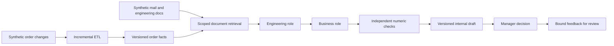

# Architecture and runtime boundaries

The runnable system is a local engineering prototype. Every fixture is invented. The existing cloud architecture is the deployment target; service logos are not evidence that those services run here.

The overview preserves the agreed cloud target and its service logos. The runnable local flow below implements the business and data contracts without deploying those services.

Risk training runs separately on point-in-time historical order, capacity and planning snapshots. It produces a frozen numeric model consumed by the engineering role. Model evaluation uses a later time period and the same alert budget as rules. The current result keeps rules as the baseline; the synthetic model is advisory and unpromoted.

## Contracts between modules

| Boundary | Input / output | Invariant |
|---|---|---|
| ETL → published facts | Owned events → versioned order lines | Invalid batches cannot publish or advance the checkpoint |
| Facts + documents → retrieval | Trusted actor/customer/project scope → current cited passages | Another customer's facts and superseded/deleted/revoked evidence cannot enter the result |
| Retrieval → engineering | Bounded evidence and approved cost → compact cost, constraints and risk handoff | Required conditions survive; money comes from approved facts |
| Engineering → business | Validated cost and constraints → three quote options | Integer-cent arithmetic, no unsupported volume savings |
| Worker → draft store | Captured source/config/model fingerprints → immutable payload | Changed evidence or invalid numeric output prevents a valid current draft |
| Draft → manager | Exact revision and payload → internal approval or rejection | Revision invalidates prior approval; a capacity gap blocks approval |
| Manager → review queue | Reason, note, revision and fingerprints → pending-review feedback | Disagreement does not automatically become truth or training data |

## Local implementation versus cloud target

| Capability | Runs locally | Target integration |
|---|---|---|
| Raw event retention | Pinned fixture batches and SQLite | S3 and approved internal/Gmail ingestion |
| Business tables and features | SQLite plus point-in-time Python pipeline | Existing Snowflake CRM tables, dbt and Airflow |
| Document retrieval | Scoped English keyword ranking and parent expansion | Cortex Search with the same authorization/version contract |
| Risk training and scoring | scikit-learn training; portable numeric JSON inference | SageMaker training and approved Snowflake batch scoring |
| Agent orchestration | Deterministic engineering/business roles and a local queue | LLM-backed roles and LangGraph/Bedrock AgentCore |
| Model call interface | Guarded model roles and injected fake SDK contracts | Approved Bedrock inference; real model quality remains unmeasured |
| Manager experience | Decision Workspace with guided follow-ups | Enterprise identity, general chatbot and approved integrations |
| Evaluation | Local regression, fault injection and evidence snapshots | Broader LLM evaluation, continuous traces and controlled rollout |

Snowflake/Gmail adapter call contracts are tested with fake clients. No live cloud connection, authentication, deployment, token meter or LLM quality result is claimed. See [implementation status](../docs/implementation-status.md) and [API contracts](../docs/api-adapters.md).

## Deliberate trade-offs

- Two roles follow a fixed dependency: engineering validates costs and constraints before business prices options. Open-ended delegation adds little value to this first demo.
- The local HTTP action returns a queued job ID; one process-local worker produces the draft. This is not a distributed worker fleet. Completed sessions can be resumed; interrupted queued/running work is not silently replayed.
- The UI can approve an internal draft, but there is no customer sender. Source validation across separate stores is not a distributed transaction.
- Shared capacity uses an aggregate line calculation. It demonstrates competition from other commitments; it is not a detailed scheduling optimizer or evidence of causal business benefit.
- Unit tests and known faults validate explicit contracts. An LLM provider still needs independent response-quality, prompt-injection and tool-selection evaluation before any production claim.

Follow [the showcase walkthrough](../docs/showcase.md) to reproduce the business example and its evidence.
