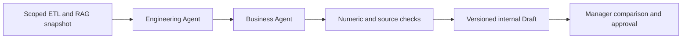

# Local Multi-Agent review

v0.3 adds a deterministic two-role workflow on top of the v0.2 data and risk modules. It uses the existing ETL, scoped RAG and trained numeric risk-model export. No LLM, cloud SDK, LangGraph, AgentCore or paid API is called. Publishing this source does not deploy a cloud service.

## Run

```bash
.venv/bin/python -m scripts.run_agents
.venv/bin/python -m scripts.verify --agents
```

The first command trains the existing small synthetic Risk Model once during setup, then prints the workspace containing `initial.txt`, `revised.txt`, `report.json`, `model.json` and `drafts.db`. `--model RUN/model.json` reuses an existing local artifact instead. If adjacent training data is available, its hash must match the model before feature ranges are attached. Manager revisions do not retrain the model.

`--agents` verification also enables the existing risk verification and requires zero skipped tests. The full local report is written to `docs/evidence/agents.json`; runtime databases and model artifacts stay in ignored `artifacts/`. Consult the hosted CI run for the current commit; an older v0.2 run does not validate these additions.

New files are not staged; the exact-index release check therefore remains pending until approval and staging. A neutral-copy candidate scan checks the proposed content without changing Git. Full local verification requires zero skips, includes workflow unit tests and all 14 runnable scenario checks, and now adds nine controlled Agent Eval experiments plus a manager-feedback/revision evaluation. See [Evaluation Studio](eval-ui.md) and [verification evidence](evidence/verification.json) for the latest actual counts.

The live [Decision Workspace](showcase.md) runs this workflow in the browser. Its local worker handles queued generation, while the manager can compare options, use guided follow-ups, approve internally, reject with a structured reason and revise quantity. Completed sessions persist for review; this is a local process, not a distributed job service.

## Roles and tools



The engineering role reads the current approved cost, checks the four reviewed source conditions, calculates total cost and calls the existing local risk scorer. It returns a compact structured handoff: costing, cited constraints and risk/features. The business role consumes that handoff and creates retain-price, customer-request and counteroffer options. Both roles share one captured source snapshot; they do not copy unbounded chat histories between agents.

Amounts are integer cents. Percentage requests use basis points. Separate validation checks unit cost against ETL, preserves all source conditions and recomputes revenue, cost, profit and margin. An incorrect engineering amount stops before the business role; an incorrect business amount prevents publication. The role interfaces accept copied inputs, so modifying an agent's local copy cannot rewrite the coordinator's source facts.

## Walk through the discount

1. A manager submits the scoped request. A SQLite job is queued; analysis has not run yet. A local worker claims it and retrieves current order v3 / design D2 plus four current passages from RAG.
2. The current order is 12,000 units at USD 13.00 cost and USD 15.00 selling price. The mail requests 5% off but has no signed additional volume. Engineering preserves the required material and inspection; no volume cost reduction is approved.
3. Engineering totals cost at USD 156,000. The toy shared-line check has 16,000 committed units against 18,000 usable units, with one production slot of slack. The reused synthetic model produces about 16.48 / 100 for these inputs. This is not a validated real-world probability.
4. Business proposes three options:

| Option | Unit price | Revenue | Gross profit | Gross margin | Demo pricing check |
|---|---:|---:|---:|---:|---|
| Retain price | $15.00 | $180,000 | $24,000 | 13.33% | Pass |
| Requested 5% discount | $14.25 | $171,000 | $15,000 | 8.77% | Fail |
| Margin-floor counteroffer | $14.45 | $173,400 | $17,400 | 10.03% | Pass |

The 10% minimum is an invented demo policy. The cent floor is rounded upward so rounding cannot accidentally approve a price below the limit. It is not a claim that USD 14.45 maximizes win rate. Engineering simplification remains an unpriced task for separate review.

5. A manager asks `discount_limit`. The response explains the requested margin and counteroffer with source references; it does not rerun either agent. Supported local follow-ups are `discount_limit`, `volume_change` and `delivery_risk`, not a general chatbot.
6. A manager can approve the counteroffer for internal review. The approval binds actor, revision, payload hash and input fingerprints. Customer dispatch is disabled.

A manager can instead reject a current draft with a reason and a bounded note. Rejection and its audit event are stored atomically. Feedback binds the original payload, revision and source fingerprints and starts as `pending_review`. The rejected draft cannot be approved. A later quantity revision can reference it, while preserving the feedback history. Disagreement is not automatically a model error or a training label. Repeated approval or feedback submissions do not duplicate the original event/record.

## Quantity revision: 12,000 to 18,000

Submitting the manager what-if creates revision 2 and atomically marks revision 1 superseded. The old approval is retained as history but is no longer valid, even if the new job later fails. The worker rechecks source access and evidence before recomputing:

| Field | Original | Revised |
|---|---:|---:|
| Published order quantity | 12,000 | 12,000 |
| Scenario quantity | 12,000 | 18,000, hypothetical |
| Unit cost | $13.00 | $13.00 |
| Total scenario cost | $156,000 | $234,000 |
| Counteroffer unit price | $14.45 | $14.45 |
| Counteroffer revenue | $173,400 | $260,100 |
| Counteroffer gross profit | $17,400 | $26,100 |
| Shared-line load | 88.89% | 122.22% |
| Aggregate schedule slack | +1 slot | −3 slots |
| Capacity shortfall | 0 | 4,000 units |
| Synthetic risk score | 16.48 | 60.75, outside training quantity range |
| Draft state | `needs_review` | `needs_capacity_review` |

Quantity changes total cost, quote totals, capacity load, schedule slack, allocation utilization and risk score. Unit cost, model parameters and unchanged source documents are reused. Confirmed pickup is not increased just because a manager proposed more units. The what-if never updates the ETL order or creates a customer commitment.

The new draft cannot be approved until capacity is resolved through a future explicit planning workflow. The model score does not authorize delivery: the capacity block is a deterministic arithmetic rule. The score is advisory and marked unpromoted; the revised quantity exceeds the training range. A smaller 10,000-unit what-if can pass the local capacity check, as a separate unit test verifies.

## Evaluation evidence

The runnable review report contains 14 scenario checks. Behavior tests additionally cover:

- Scope/owner denial and revoked access, including revocation during generation.
- Idempotent submissions and revisions, a single worker claim, durable completed drafts and no duplicate analysis on repeated worker calls.
- Hand-checked cent amounts, floor rounding, invalid quantities, float-output rejection and injected arithmetic errors in either role.
- Missing conditions, ambiguous discount requests and refusing to take monetary costs from email text.
- Shared-capacity accounting, training-range warnings, unchanged unit cost and no write-back from what-if quantities.
- Stale approval after quantity, document, ETL, pricing-policy or model changes.
- Approval bound to immutable payload; tampered stored content is rejected.
- Manager follow-up reuses the existing draft without new agent/tool analysis.

Inspect `report.json` for both drafts and per-job traces: queue, scoped retrieval, engineering tools/handoff, business options, publication validation, manager follow-up, internal approval and invalidation. Trace entries contain local source IDs and results; no paid token usage is implied.

## Boundaries

This is a small deterministic role workflow, not an autonomous LLM system. Extraction rules pin reviewed passages; unseen wording or a new document version can block rather than generalize. These tests validate known business boundaries and injected bad outputs, not LLM hallucination rates or prompt-injection resistance.

The queue provides a durable submission boundary and one local claim; the CLI explicitly runs the worker. There is no deployed background fleet, lease timeout, automatic retry of a crashed `running` job or distributed exactly-once guarantee. A failed/superseded job needs a new explicit request. General model/provider adapters and LangGraph/AgentCore deployment remain planned.

Permissions are static demo grants, not authentication. Rechecking separate source stores is not a cross-system atomic transaction; a production sender still needs version-bound validation at dispatch. There is no external sender here. Old approvals and artifacts remain audit history and are not physically erased on access revocation. The aggregate line calculation is not a detailed multi-project scheduler and cannot prove that every other order remains on time.
